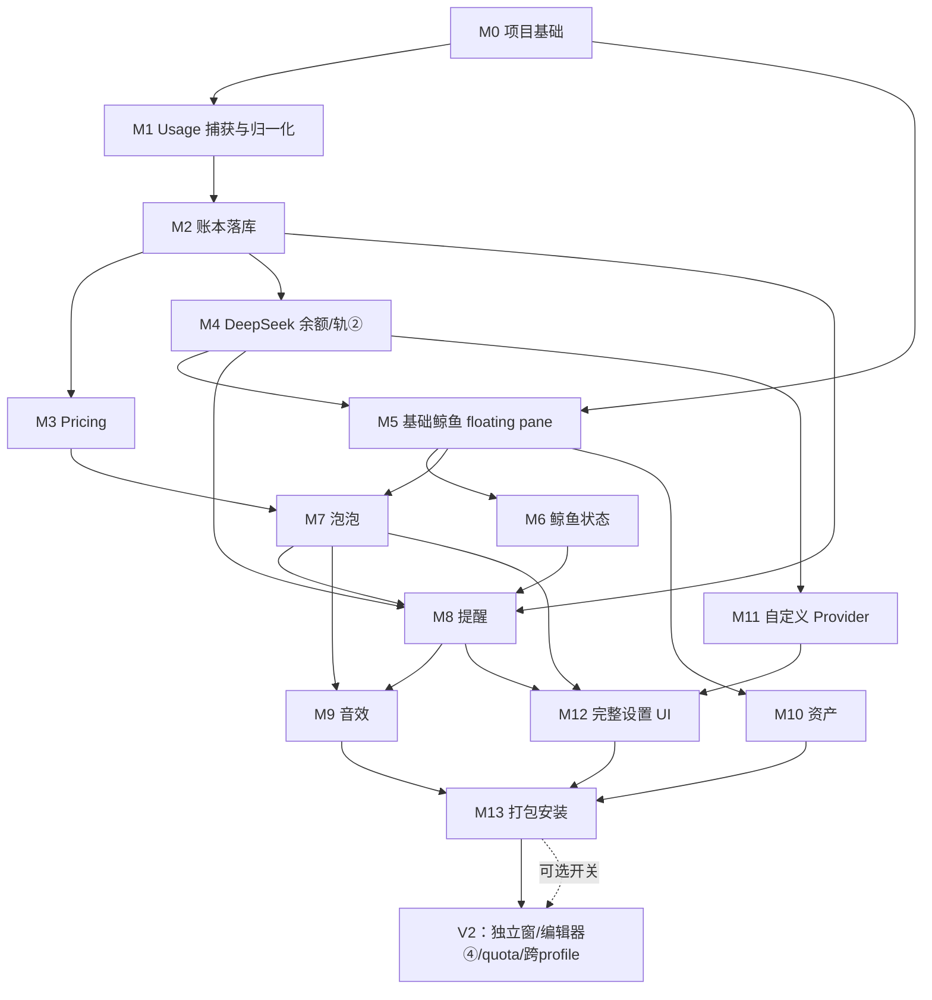

# hermes-whale-widget 实施计划（IMPLEMENTATION_PLAN）

> 版本 v1.0（2026-10-03）。Phase 5 产物。
> 上游输入（按权威顺序）：
> - `AGENTS.md`（最高约束）与 `README.md`（环境事实）
> - `docs/design/ARCHITECTURE_DECISION.md`（下称 **[AD]**，DR-1~DR-14 为既定决策）
> - `docs/design/DATA_MODEL.md`（下称 **[DM]**，10 实体 + 3 支撑结构 + DDL 草案）
> - `docs/design/FEASIBILITY_REPORT.md`（总体 PARTIAL 趋近 FULL；三处降级）
> - `docs/design/FEATURE_MATRIX.md`（A14/B10/C12/D0/E1）
> - `docs/research/DEEPSEEK_WHALE_ANALYSIS.md`（下称 **[DSH]**）、`HERMES_ARCHITECTURE_AUDIT.md`（下称 **[AUDIT]**）、`REFERENCE_PROJECTS.md`（下称 **[REF]**）
> - 配套测试计划：`docs/plans/TEST_PLAN.md`（下称 **[TP]**）
>
> 本文所有 `未验证` 标注 = 证据不足以判定，实施前必须先做只读探查（允许读 `D:\hermes`）。

---

## 0. 使用说明（给下一个 coding agent）

1. **开工前必读**：`AGENTS.md` 全文 → 本文 §1-§4 → 当前 Milestone 小节 → [DM] 对应章节。任何代码修改前先读 `AGENTS.md`。
2. **硬约束复述**（违反即事故）：只改 `E:\hermes_plugin\hermes-whale-widget\`；`D:\hermes` 一律只读；禁止修改 Hermes Core；禁止明文存储/输出 API Key；余额 API 失败 ≠ 0；账本写入必须幂等。
3. **文档同步义务**（AGENTS.md §4）：每完成一个 Milestone 更新 `docs/progress/WORKLOG.md`；实现与计划不一致时**必须同时改本文**；架构变更同步 [AD]。
4. **任务清单的粒度约定**：本文任务精确到「文件路径 + 模块职责」；函数级实现细节以 [DM] 的数据规则与 [DSH] 的算法引用为准，本文不重复。
5. **部署红线**：本项目**不自动部署**。一切写入 `D:\hermes` 的动作（复制插件、改 `config.yaml` 白名单、重启验证）由用户手动执行或逐次显式授权（AGENTS.md §0.4）。开发期验证手段 = 静态检查 + 单元/契约测试 + 独立预览页（§3.3）。
6. 测试编号（`ACC-01` 等）定义见 [TP]；各 Milestone 的「涉及测试」直接引用。

---

## 1. 版本分层（先于 Milestone）

> 分层原则：MVP 先形成**数据正确性闭环**（对标 [DSH] §A 记账 + §D 提醒主干），V1 补齐 DSH 的体验层（音效/素材/编辑器/多厂商）并形成可分发产物，V2 收纳 Phase 2 增强与全部「进阶/未验证」项。

### 1.1 分层总表

| 分层 | 包含 Milestone | 功能范围（对标 DSH 全功能清单） | 明确不进该层的内容 |
|---|---|---|---|
| **MVP（闭环版）** | M0–M8（9 个） | usage 捕获归一化 → 幂等落库 → 计价 → DeepSeek 余额 + 双轨记账 → floating pane 鲸鱼展示（余额/今日消费双轨并排）→ 鲸鱼基础交互与状态 → 泡泡（默认内容 + 每轮消耗 + 余额变化）→ 提醒四类（预算/余额预警/每轮消耗/等待） | 音效（M9）、素材体系（M10）、多厂商 Provider（M11）、泡泡编辑器（M12）、打包分发（M13） |
| **V1（功能完整版）** | M0–M13（14 个） | MVP + 四类事件音效 + 默认/自定义角色与图片库（**素材全部自产**）+ 自定义余额类 Provider + 完整设置 UI（含泡泡编辑器第③阶段）+ 发布包与安装文档 | 泡泡编辑器第④阶段、quota 订阅额度窗口、独立透明窗、自定义音效组（→V2） |
| **V2（增强版）** | 不再细分编号（§6） | Phase 2 独立透明鲸鱼窗（[AD] DR-4 的 C 路线开关）；泡泡编辑器④（A/B 加权并列、模块库、悬浮快捷编辑、系统字体枚举、触摸长按）；quota 订阅额度窗口 + 多窗口重置倒计时；自定义音效组/导入裁剪；跨 profile 汇总；月度预算；峰谷价目（若引入）；远程 Hermes 内嵌形态实测结论 | — |

### 1.2 取舍理由（对标 DSH 全功能清单）

- **MVP 只保留「账要准 + 看得见 + 提醒得到」**。理由：AGENTS.md §8 记账正确性红线是全项目最高技术风险（幂等、五类金额分离、余额五状态机），必须最早在最小面积上闭环验证；音效/素材/编辑器不触碰数据面，后置不增加返工。
- **编辑器整体后置到 M12**：[DSH] 分析 §C4 证实泡泡编辑器约占 DSH 前端 1/3（约 5700 行）；[AD] DR-5 已把引擎解耦为 Definition→Resolver→RenderModel→Renderer，M7 只交付前两段 + 默认内容，编辑器（第③阶段）在 M12、进阶（第④阶段）在 V2。
- **多厂商 Provider 后置**：M4 先用 DeepSeek 单厂商把「凭据解析→出站白名单→余额状态机→差分记账」整条链路做对（这也是用户主账户），M11 再把该链路模板化复制到其它厂商——链路不变、只换模板数据。
- **quota 订阅额度整体后置到 V2**：FEATURE_MATRIX 判 C 级且依赖逐厂商探针维护（接口时效风险）；MVP/V1 的余额+估算双轨已覆盖核心记账诉求。
- **音效放 M9（V1 首个）**：任务结束音/提问音是 DSH 提醒体验的强关联项，但属纯前端 Web Audio，无数据面依赖，放 MVP 之后首个里程碑风险最低。
- **打包安装放最后（M13）**：catalog 发布需要 GitHub repo + SHA pin，且「统一包 + `plugins.enabled` + 重启」的安装流程需先在 dev 部署（用户手动复制）中验证过。

---

## 2. Milestone 总览、依赖图与退出条件

### 2.1 总览

| ID | 名称 | 分层 | 硬前置 | 交付要点 |
|---|---|---|---|---|
| M0 | 项目基础（三半体骨架） | MVP | — | Unified Package 目录、配置/日志/DB 脚手架、构建与测试脚手架、REST 骨架 |
| M1 | Usage 捕获与归一化 | MVP | M0 | EventNormalizer + IngestClient + ingest 契约（Python 侧 stub） |
| M2 | 账本落库 | MVP | M1 | SQLite whale.db 全量 v1 schema、幂等 ingest、watermark、日聚合 |
| M3 | Pricing | MVP | M2 | 成本结算三级 basis、内置价目 + 自定义单价数据层、1e8 定点 |
| M4 | DeepSeek 余额（轨②） | MVP | M2 | ProviderGateway、凭据指纹、余额五状态机、差分记账、校正端点 |
| M5 | 基础鲸鱼（floating pane） | MVP | M0（数据展示依赖 M2/M4） | pane 宿主 + 鲸鱼占位资产 + 芯片 + 双轨数值展示 |
| M6 | 鲸鱼状态 | MVP | M5 | 归一化事件驱动的状态机 + 拖拽/点击/按压/翻转/吸附 + 位置记忆 |
| M7 | 泡泡 | MVP | M5、M3 | 泡泡管线（Schema→Resolver→RenderModel→Renderer）+ 系统泡泡队列 + 默认内容 |
| M8 | 提醒 | MVP | M2、M4、M7 | Rules + notification 持久去重 + Question(A 级事件) + Approval(agent hook 桥) + 等待泡 |
| M9 | 音效 | V1 | M7、M8 | Web Audio 引擎 + 四类事件音 + 音量三态 + 开关 |
| M10 | 资产 | V1 | M5 | 自产默认素材 + 自定义角色/图片库 + 透明命中测试 |
| M11 | 自定义 Provider | V1 | M4 | Provider 模板注册表 + CRUD + match_ids 归因 + 无余额接口类 |
| M12 | 完整设置 UI | V1 | M7、M8、M11 | 设置页全部分区 + 泡泡编辑器③ + 校正窗口 + 配置持久化分工 |
| M13 | 打包安装 | V1 | 全部 | 发布包、catalog sidecar、安装/卸载文档、准入 lint 自检 |

### 2.2 依赖关系图



ASCII 备份（关键主链）：

```
M0 ── M1 ── M2 ── M3 ──┐
 │          │          ├── M7 ── M8 ── M9 ──┐
 │          │   M4 ────┤      ↑↑(M2/M4/M6)   ├── M13
 └── M5 ── M6 ── M7 ───┘                     │
       └─────────────── M10 ─────────────────┤
                M4 ── M11 ── M12 ────────────┘
```

### 2.3 每阶段退出条件

| 阶段 | 退出条件（全部满足才可宣布） |
|---|---|
| **MVP** | ① 真机（用户配合部署）跑通闭环：发送一轮对话 → `message.complete` → TurnCost 落库（唯一一条，重放不重复）→ 每轮消耗泡泡 → 今日消费双轨数字更新；② 余额轮询进入 `ok` 态且差分记账正确（充值不冲销）；③ 余额低于阈值/预算超限各弹一次且重启后不重响（持久去重）；④ Question/Approval 等待泡出现与清除正确；⑤ [TP] 中 M0–M8 关联测试全绿；⑥ WORKLOG 与本文同步。 |
| **V1** | MVP 全部保持 + ① 四类事件音效可开关可调音量；② 默认素材为自产且 ASSETS.md 记录来源；③ 至少 1 个非 DeepSeek 余额类 provider 实配可用；④ 泡泡编辑器③完成（增删/排序/文本与数值模块/保存恢复默认）；⑤ 发布包按 M13 清单产出且准入 lint 自检通过；⑥ [TP] 全部 L1-L3 测试绿 + 手动验收清单执行完毕。 |
| **V2** | 按项独立验收（§6），不设统一门槛。 |

---

## 3. 源码树、运行时布局与构建策略

### 3.1 源码树（M0 建立；根目录 = `plugin-src/hermes-whale-widget/`）

```text
plugin-src/hermes-whale-widget/
├── catalog/
│   └── whale-widget.yaml            # catalog PR sidecar（M13 定稿；M0 建草稿）
├── plugin.yaml                      # agent 半体清单（name/version/description）
├── __init__.py                      # agent 半体入口：register(ctx) 注册 approval hooks（M0 为 no-op，M8 实现）
├── whale_agent/
│   └── approval_hook.py             # M8：pre_approval_request / post_approval_response → 原子写状态文件
├── dashboard/
│   ├── manifest.json                # {name:"whale-widget", label, icon, version, api:"plugin_api.py"}
│   ├── plugin_api.py                # FastAPI router 薄入口（sys.path bootstrap 后转授 whale_core）
│   ├── whale_core/                  # Python 半体包（唯一业务逻辑区）
│   │   ├── __init__.py
│   │   ├── config.py                # 数据目录解析(<HERMES_HOME>/whale-widget/)、config.json 读写（原子写+默认合并）
│   │   ├── logging_setup.py         # 轮转 5×1MB + 脱敏过滤器（sk-/Bearer/Authorization，[DM] §8.4）
│   │   ├── db.py                    # SQLite 连接（WAL、synchronous=FULL、busy_timeout、损坏 fail-closed）
│   │   ├── migrations.py            # schema_migrations 列表 + 写前备份 whale.db.bak-<ver>
│   │   ├── ingest.py                # POST /ingest/turn：dedup_key、watermark、turn_seq、INSERT OR IGNORE
│   │   ├── usage_ledger.py          # 轨①聚合查询（today/7d/per-model/per-day）
│   │   ├── pricing.py               # 内置价目表 + 自定义单价（校验沿 [DSH] F3）+ cost_basis 决策
│   │   ├── balance_ledger.py        # 轨②：snapshot 写入、差分、adjustment（revision 409）、日行物化
│   │   ├── providers/
│   │   │   ├── base.py              # httpx 客户端：超时 15s、5xx/网络重试 1 次、in-flight 去重
│   │   │   ├── gateway.py           # get_secret 解析、指纹、出站白名单、assertSafeApiUrl 移植
│   │   │   ├── deepseek.py          # M4 首个厂商（/user/balance，多币种选择规则）
│   │   │   └── registry.py          # M11：厂商模板注册表（纯数据 + 探活/取数执行器）
│   │   ├── rules.py                 # 预算/预警阈值评估 → notification 表（去重键 [DM] §2.10）
│   │   ├── wait_bridge.py           # 等待面统一出口：approval 状态文件 + question 事件落库 → /wait-state
│   │   ├── notifications.py         # notification 表读写、WS 推送 + 轮询 fallback 数据源
│   │   ├── track3.py                # 轨③：state.db mode=ro + schema_version 门（[DM] §4.4）
│   │   ├── archive.py               # 保留策略（[DM] §5）：每日 tick + turn 结算顺手 prune
│   │   └── security.py              # 写端点回环校验、字段命名 lint（禁止裸 cost/spend/used 出 REST）
│   └── tests/                       # pytest（L1/L2/L3，见 [TP]）
├── desktop/
│   ├── plugin.js                    # 【构建产物】单文件 ESM（import 白名单：@hermes/plugin-sdk + react*）
│   ├── src/
│   │   ├── main.js                  # register(ctx)：注册 pane/route/chip、ctx.onEvent 订阅、装配 IngestClient
│   │   ├── core/
│   │   │   ├── normalize.js         # Hermes 事件 → 9 个归一化鲸鱼事件（[AD] §4）；字段全 NULL 感知
│   │   │   ├── ingest-client.js     # POST /ingest/turn 转发：退避重试、断连暂停、重连对齐标记
│   │   │   ├── wait-events.js       # M8：clarify tool.start/complete 观测 → POST /ingest/wait-event
│   │   │   ├── money.js             # 定点 1e8 运算与显示（toFixed(2)，与 Python 侧口径一致）
│   │   │   └── pricing.js           # 显示层兜底价目（只读快照，权威结算在 Python）
│   │   ├── ui/
│   │   │   ├── whale-pane.js        # floating pane 宿主（React 薄壳 + 命令式 DOM/Canvas 内核）
│   │   │   ├── whale-actor.js       # 鲸鱼渲染与状态机、pointer 交互（拖/点/按压/翻转/吸附）
│   │   │   ├── bubble/
│   │   │   │   ├── schema.js        # Row/Module schema 校验（[DSH] C2 子集，v1）
│   │   │   │   ├── resolver.js      # Definition → Render Model（占位符、加权随机、avoidIdx）
│   │   │   │   ├── renderer.js      # Render Model → DOM（行合并、样式、ticker、`—` 语义）
│   │   │   │   └── queue.js         # 系统泡泡优先队列（rank/合批/TTL 巡检/等待常驻/降级 toast）
│   │   │   ├── statusbar.js         # 状态栏芯片（今日估算/余额摘要，ai-usage-tracker 已验证模式）
│   │   │   └── settings/            # M12：设置页各分区组件（route + nav 注册）
│   │   └── sound/                   # M9：engine.js（Web Audio 预解码/排期/生命周期）、volumes.js
│   └── tests/                       # node --test（core/ 纯逻辑单测，见 [TP]）
├── assets/                          # 自产素材（M5 占位鲸鱼、M10 正式素材、M9 默认音效）+ ASSETS.md 溯源
└── INSTALL.md                       # M13：安装/启用/卸载/回滚/数据位置
```

项目根另建（AGENTS.md §2 约定）：

```text
tools/
├── build-desktop.mjs        # esbuild 打包 desktop/src → desktop/plugin.js（externals 见 §3.3）
├── check-security.mjs       # 静态检查：plugin.js import 白名单、sk-/Bearer 扫描、禁 eval/原型补丁
├── dev-preview.mjs          # 本地静态服务 + SDK shim（无 Hermes 环境预览鲸鱼/泡泡 UI）
├── mock-provider-server.mjs # [TP] 本地假 provider（余额/探活端点，供预览页与手动验证）
└── replay-events.mjs        # [TP] 事件重放 harness：fixtures JSONL → normalize → 本地 FastAPI
```

### 3.2 运行时持久化布局（Python 半体负责创建；= [AD] §6）

```text
<HERMES_HOME>/whale-widget/          # 每 profile 作用域（serve 的 secret scope 内）
├── whale.db / -wal / -shm           # SQLite WAL，全部账本（[DM] §7.2 DDL）
├── config.json                      # 无密钥配置（阈值/泡泡/轮询开关/实验开关）
├── credentials.json                 # 兜底凭据，仅 secret_sources 与 env 均不可用时启用
├── approval-state.json              # M8：agent 半体 hook 写入的审批挂起状态（原子写）
├── logs/whale-widget.log            # 轮转 5×1MB，脱敏规则同 [DM] §8.4
└── window/                          # （V2）whale-window-state.json 握手 + app-online.json 心跳
```

- **数据与代码分离**：绝不写入 `plugins/whale-widget/`（catalog 按 SHA 原子发布会清掉它，[AUDIT] §7.3）。
- JS 半体侧：`ctx.storage`（键 `hermes.plugin.whale-widget.*`）只放纯 UI 偏好（位置记忆、去重标记、音量滑块值）；媒体资产放 IndexedDB；**严禁**存放任何密钥。

### 3.3 构建策略：plugin.js 手写级单文件 ESM（无官方打包工具）

事实（[AUDIT] §1.4）：Hermes 无官方「TS/JSX → plugin.js」打包工具；runtime-loader 只接受**单文件纯 ESM**，import 白名单 = `@hermes/plugin-sdk` + `react` / `react/jsx-runtime` / `react/jsx-dev-runtime`，一切 bare specifier 之外的导入（含 URL）被拒。

**决策**：源码按模块开发（`desktop/src/**`），用 **esbuild** 打成单文件 `desktop/plugin.js`：

- `--format=esm --platform=browser --bundle`
- `--external:@hermes/plugin-sdk --external:react --external:react/jsx-runtime`（保留 bare import → 由 runtime-loader 改写为 shim blob）
- `--jsx=automatic`（React 19 jsx-runtime；JSX 只用于 pane/设置页薄壳，泡泡渲染与动画走命令式 DOM/Canvas 以对齐 [DSH] 渲染纪律）
- `--target=chrome120`（Electron 40 渲染层；保守值）
- esbuild 记录为 devDependency（AGENTS.md §10 要求记录理由：无官方打包链，单文件产物是 runtime-loader 硬要求）。
- **回退方案**：若 esbuild 产物触发未知的加载器校验问题（未验证），降级为 ai-usage-tracker 式手写单文件 ESM（其 21KB 手写件已实证可加载）；`tools/check-security.mjs` 对产物做与官方 admission lint（`plugin_validate_desktop.py`）同构的静态自检：禁原型补丁、eval/new Function、白名单外动态 import、`<script>` 注入。
- **热重载开发流**：构建产物落在源码树 `desktop/plugin.js` → 用户手动复制到 `D:\hermes\desktop-plugins\whale-widget\plugin.js`（或统一包 `desktop/` 半体）→ fs-watch 自动重载；**每次复制需用户执行或显式授权**。

### 3.4 REST/WS 契约总表（挂载于 `/api/plugins/whale-widget/`）

| 端点 | 方法 | Milestone | 说明（响应字段命名强制遵守 [DM] §8.1 前缀规范） |
|---|---|---|---|
| `/health` | GET | M0 | `{plugin, schema_version, track3_state, contract_probe}` |
| `/ingest/turn` | POST | M1 契约 / M2 实现 | 幂等：`{status:'accepted'\|"duplicate"}`；载荷含 `after_reconnect` 标记 |
| `/ingest/wait-event` | POST | M8 | question 挂起/解除上报（tool.start/tool.complete 转发） |
| `/usage/summary` | GET | M2/M3 | `{estimated_today, estimated_days7[], tokens_json, per_model[], partial_flags}` |
| `/usage/turns` | GET | M2 | 最近 N 轮（泡泡/明细用） |
| `/balance` | GET | M4 | `{state, observed_balance, granted, topped_up, currency, stale, fetched_at, fingerprint}` |
| `/balance/summary` | GET | M4 | 轨②日聚合（`observed_spend`/`credit`/`needs_review`） |
| `/balance/refresh` | POST | M4 | 手动刷新（绕缓存） |
| `/balance/adjustment` | POST | M4 | 校正；revision 不匹配 → 409 |
| `/wait-state` | GET | M8 | `{question_slots[], approval_slots[], fired_dedup_keys[]}` |
| `/notifications` | GET / POST dismiss | M7/M8 | 优先队列数据源（`kind/rank/payload_json/ttl_ms`） |
| `/config` | GET / PUT | M0 读 / M12 写 | config.json 白名单字段校验；**永不返回/接受密钥** |
| `/providers` CRUD + `/providers/{id}/test` | M11 | 模板实例管理 + 探活/取数测试 |
| `/ws`（可选） | WS | M8 | 通知推送；**必须保留 3s 轮询 fallback**（OAuth remote 上 ctx.socket no-op，[AUDIT] §6.3） |

---

## 4. Milestones

> 每个里程碑固定六要素：目标 / 任务清单 / 验收标准 / 涉及测试 / 回滚方式 / 预估风险。
> 「真机验收」类条目均需用户配合（复制部署 + 重启 + 操作），见各里程碑标注与 [TP] §4.10。

---

### M0 项目基础（三半体骨架）

**目标**：Unified Package 三半体（agent / dashboard / desktop）骨架可构建、可静态验证、可被用户一次性部署启用；Python 侧配置/日志/DB 脚手架就绪；dev 命令与测试脚手架落地。**Python 半体启用需重启 App，所以骨架必须一次搭全**（任务修正 c）。

**任务清单**：
1. 建立源码树（§3.1 全部目录与空实现占位）：`plugin.yaml`、`__init__.py`（no-op `register(ctx)`，照抄 ai-usage-tracker `__init__.py:17-19` 范式）、`dashboard/manifest.json`、`dashboard/plugin_api.py`（`GET /health`）、`desktop/plugin.js`（最小 register：状态栏芯片占位 + `host.notify` 自检 toast）。
2. **只读探查并记录**（结果进 WORKLOG，供 M8 用）：① `D:\hermes\hermes-agent\hermes_cli\web_server_dashboard.py:805-905` 的 plugin_api.py importlib 导入机制（决定 `whale_core` 包用 sys.path bootstrap 还是单文件）；② PluginManager 对 agent 半体的导入布局（`hermes_cli/plugins.py`，与 `D:\hermes\plugins\ai-usage-tracker\` 结构比对）。**未验证项，实施前必须探查**。
3. `whale_core/config.py`：数据目录 `<HERMES_HOME>/whale-widget/` 解析（支持测试注入 `HERMES_HOME` 环境变量）、config.json 原子写 + 默认值深合并；`logging_setup.py`：RotatingFileHandler 5×1MB + 脱敏 Filter（`sk-`/`Bearer `/`authorization` 键值对）。
4. `whale_core/db.py` + `migrations.py`：连接参数（`PRAGMA journal_mode=WAL; synchronous=FULL; foreign_keys=ON; busy_timeout=5000`）、损坏检测 fail-closed（转储 `.corrupt-<ts>` 拒写）；迁移 v1 = **[DM] §7.2 全量 DDL**（一次建齐 10 实体 + 3 支撑 + 归档表，避免开发期迁移churn；后续演进走 v2+，写前备份 `whale.db.bak-<ver>`）。
5. `whale_core/security.py`：写端点回环来源校验依赖；REST 字段命名 lint 辅助（禁止裸 `cost/spend/used` 键出 REST，[DM] §8.1）。
6. 构建与检查工具：`tools/build-desktop.mjs`（§3.3 参数）、`tools/check-security.mjs`；`package.json`（devDependencies：esbuild；scripts：build/test/lint/check）。
7. 预览脚手架：`tools/dev-preview.mjs` + `tools/` 内 SDK shim（stub `host`/`ctx` 最小面：register/onEvent/rest/storage/notify），加载 `desktop/plugin.js` 渲染占位 pane。
8. 测试脚手架：`dashboard/tests/conftest.py`（tmp HERMES_HOME fixture、临时数据目录）、`test_health.py`、`test_config.py`、`test_logging_redaction.py`、`test_migrations.py`；`desktop/tests/`（`node --check plugin.js`、import 白名单断言）。
9. 回填 `AGENTS.md` §5 命令区与 `README.md` 开发测试节（确切命令以脚手架实测为准）。

**验收标准**：
- `node tools/build-desktop.mjs` 产出单文件 ESM；`node tools/check-security.mjs` 通过（白名单内 import、无禁用模式）。
- `pytest dashboard/tests -q` 全绿（含：迁移可重复执行幂等；脱敏后日志不含密钥样例；config 深合并正确）。
- `node tools/dev-preview.mjs` 打开后可见占位芯片/pane，控制台无未捕获错误。
- `curl`-able `/health`（经 TestClient）返回 schema_version。
- 用户手动部署路径文档化（草稿）：复制到 `D:\hermes\plugins\whale-widget\` + `config.yaml` `plugins.enabled` 加名 + 重启 App + Plugins 页启用桌面半体（opt-in）。

**涉及测试**：[TP] SEC-01/02（日志脱敏、无密钥落盘）、CON-00（健康检查）、L1 脚手架自身。

**回滚方式**：删除 `plugin-src/hermes-whale-widget/` 与 `tools/` 新增文件即可；运行时数据目录仅在真机运行后产生，卸载时由用户按 INSTALL.md 删除。

**预估风险**：agent 半体导入布局与 plugin_api.py 同包导入机制**未验证**（任务 2 探查兜底；最坏情况 dashboard 退化为自包含单文件 + agent 半体保持 no-op，不影响 MVP 主链）；esbuild 产物兼容性未验证（§3.3 回退方案）。

---

### M1 Usage 捕获与归一化

**目标**：JS 半体订阅网关事件并归一化为 9 个鲸鱼事件（[AD] §4）；turn 终值 usage 按契约转发 Python；心跳永不落库原则在代码结构上成立。

**任务清单**：
1. `desktop/src/core/normalize.js`：映射 `message.start/message.delta/session.usage/message.complete/tool.*/error/gateway.reconnecting/host.state.gateway` → 归一化事件；`message.complete` 按 `status`（complete/error/interrupted）分流；usage 字段**全 NULL 感知**（`Usage` 接口全可选，[AUDIT] §12；缺省不造 0）；payload 提取只留白名单字段（[DM] §8.4）。
2. `desktop/src/core/ingest-client.js`：POST `/ingest/turn`（载荷：`session_id/profile/model/usage 累计快照/raw usage 子对象/received_at/status/after_reconnect`）；指数退避重试（上限 3 次，失败进内存死信并 UI 提示「记账暂不可用」）；`gateway.reconnecting` 期间暂停发送并在恢复后给后续 complete 打 `after_reconnect:true`（Python 侧对齐不结算，[DM] §3.4）。
3. `main.js` 装配：`ctx.onEvent` 订阅（`register` 期间订阅随插件卸载自动清理）。
4. Python 侧 stub：`ingest.py` 校验载荷结构并返回 `{status:'accepted'}`（不落库；M2 替换为真实现）；契约以 `dashboard/tests/test_ingest_contract.py` 固化（请求/响应 schema）。
5. `tools/replay-events.mjs` + fixtures：手写 `message.complete` 等事件 JSONL（字段形状照 `gateway-contract.generated.ts:4555-4571`），驱动 normalize → 本地 FastAPI 端到端断言。

**验收标准**：
- 重放 fixtures 全部产生正确的归一化事件序列（含 status=error/interrupted 分流、缺省 usage 字段 → null 不造 0）。
- ingest-client 断连/恢复模拟（mock ctx.rest）后恢复转发且带对齐标记。
- 契约测试绿：非法载荷 4xx 且错误信息不回显原始 payload。

**涉及测试**：[TP] INT-01/02（事件重放、断连重放）、CON-01（ingest 契约）。

**回滚方式**：JS 侧全部为新增文件，revert 即可；stub 端点保留不影响后续。

**预估风险**：`message.complete.usage` 实际字段形状与本机版本的偏差（**未验证**——fixtures 基于 contract 类型推导，M5 真机冒烟时用 `ctx.onEvent('*')` 记录真实事件核对并修正 fixtures）；`session.usage` 心跳字段缺省形态（只进内存，不影响落库正确性）。

---

### M2 账本落库

**目标**：轨① usage ledger 落地：幂等去重、watermark、turn 序号、日聚合、归档策略——全项目记账正确性的地基。

**任务清单**：
1. `whale_core/ingest.py` 实现替换 stub：
   - `dedup_key` 计算（[DM] §3.2 公式：session_id | day | minute_bucket | turn_seq | source_event | model | 五类 token | cost_basis | estimated_cost_units，sha256 截 40）；`turn_seq` 由 SessionWatermark 按会话持久递增；
   - `INSERT OR IGNORE` → duplicate 返回，不报错；
   - 计数器重置检测（快照 < watermark → provisional + `cost_basis='token_only'` + `reset_count+=1`，[DM] §3.3）；
   - `after_reconnect:true` 的首条 complete 只对齐 watermark 不结算。
2. 日聚合：`daily_summary(track='usage')` upsert（`estimated_cost_units` 先按 token_only/占位，M3 接管）；`day` 用本地时区（DR-12）；可注入时钟（测试跨零点）。
3. `whale_core/usage_ledger.py`：`/usage/summary`、`/usage/turns` 查询（per-model、per-day、`partial` 标记）。
4. `whale_core/archive.py`：保留策略执行器（[DM] §5.1 阈值）+ 每日 tick；Notification/Watermark 直接删。
5. `whale_core/track3.py`（可选轨，默认开）：`mode=ro` 打开 `state.db`、`schema_version` 门（已知集 {30,31}，未知 → 禁用+告警）、`PRAGMA table_info` 缺列降级；**只读、fail-open**。
6. REST 命名 lint 测试：断言 `/usage/*` 响应无裸 `cost/spend/used` 字段（[DM] §8.1）。

**验收标准**：
- 同一 turn 载荷重放 N 次 → `usage_event`/`turn_cost` 各恰好 1 行（dedup UNIQUE 生效）。
- 重启模拟（重建 db 句柄/进程内重载）后继续 ingest，无重复、无负增量。
- 多会话并发 fixtures（主会话 + subagent session_id 不同）不串账；计数器重置场景产出 provisional 行。
- 归档 tick 把超期行移入 archive 且源表删除、archive 上限生效。

**涉及测试**：[TP] ACC-01~05、ACC-10、CON-02/03、INT-02。

**回滚方式**：迁移带回滚函数（v1 → drop 新表；真机回滚 = 恢复 `whale.db.bak-*`）；`ingest.py` 退回 stub 不影响 M1 契约。

**预估风险**：dedup 公式与 [DM] 文档的偏差（用固定测试向量钉死公式）；`minute_bucket` 对真实事件时间戳来源的假设（用 `received_at` 本地截断，重放场景恒一致）；轨③ `state.db` 锁与性能（60s 读频上限 + 只读连接隔离）。

---

### M3 Pricing

**目标**：turn 成本结算落地：`hermes_estimate > whale_pricing > token_only` 三级 basis；内置价目 + 自定义单价数据层；1e8 定点整数全链路贯通。

**任务清单**：
1. `whale_core/pricing.py`：
   - 内置价目表（纯数据模块，首版覆盖本机常用模型；未覆盖模型 → token_only 诚实降级）；
   - 自定义单价 `model.pricing_json` 读写（校验：单价 0–1000000、币种合法、**不做自动汇率折算** DR-12）；
   - cost_basis 决策：`Usage.cost_usd` 存在 → `hermes_estimate`（币种 USD；`cost_status='included'` 语义的实时事件可得性**未验证**，先按 cost_usd 非空即用，真机冒烟核对订阅账号行为后修正）；否则 tokens × 自定义/内置价 → `whale_pricing`；否则 `token_only`；
   - `turn_cost.pricing_snapshot_json` 冻结当轮单价（改价不重写历史，[DM] §2.2 注）。
2. `desktop/src/core/money.js`：1e8 定点运算 + `toFixed(2)` 显示 + `—`（null）语义，与 Python 侧单测对齐同一组测试向量。
3. `ingest.py` 结算接线：M2 的占位结算替换为 pricing 决策；`reasoning` 不另计费（⊆ output，[DSH] A3 issue #89）。
4. `/usage/summary` 增加 per-model cost 与币种分列（多币种各自成账不合并）。

**验收标准**：
- 定点运算越界抛错、无浮点累积误差（与 Python 侧同向量测试）。
- 三级 basis 决策覆盖全部 fixtures（含 cost_usd 缺省、自定义价、未知模型）。
- 修改自定义单价后，历史 TurnCost 的 `pricing_snapshot_json` 不变。

**涉及测试**：[TP] ACC-06/07（pricing、rounding）。

**回滚方式**：`pricing.py` 决策函数独立可退回 token_only；无 schema 变更。

**预估风险**：`cost_status` 在实时事件中的可得性（**未验证**，真机核对项）；本机模型 slug 清单与价目表匹配规则的维护成本（子串匹配按键长降序，防 "pro" 误伤——照抄 [DSH] `priceFor` 思路）。

---

### M4 DeepSeek 余额（轨②）

**目标**：ProviderGateway + DeepSeek 余额链路 + 轨②差分记账 + 五状态机 + 校正端点；「API 失败 ≠ 0」红线落地。

**任务清单**：
1. `whale_core/providers/base.py`：httpx 封装（超时 15s；网络/5xx 重试 1 次 500ms；4xx 不重试；in-flight promise 去重——[DSH] A1 参数）。
2. `whale_core/providers/gateway.py`：
   - 凭据：`agent.secret_scope.get_secret`（profile 作用域只读；**未验证**本机 secret_sources 配置形态，M4 探查 `D:\hermes` config 样例）→ 兜底 `credentials.json`（存在才启用）；
   - 指纹：sha256(key) 前 24 位 = 轨② scope；
   - 出站白名单：目标 origin 必须等于模板写死端点；自定义 host 需 `allow_custom_host` 且由回环写请求确认；`assertSafeApiUrl` 移植（禁 169.254/云元数据/禁 userinfo，[DSH] F2）。
3. `whale_core/providers/deepseek.py`：`GET /user/balance`；多币种选择（CNY>0 → 任意非零 → CNY → 首项）；`granted/topped_up` 取不到 = NULL 不是 0。
4. `whale_core/balance_ledger.py`：snapshot 写入（UQ 去重 + `fetched_at <= last` 单调忽略）→ 差分（降=observed_spend、升=credit 不冲销）→ `daily_summary(track='balance')` 物化（含 `partial/gap_seconds`，[DM] §4.3）；`POST /balance/adjustment`（校正公式 + revision 乐观并发 409）。
5. 余额状态机（[DM] §6 五态 + FRESH_TTL 90s）：Python 半体单实例 60s 轮询 + 手动刷新绕缓存；状态与最近成功值持久化进 `whale_meta`；**error/stale/unknown 状态禁止差分记账与预算比较**。
6. 无 key 场景：`/balance` 返回 `state:'unknown'` + 原因，UI 引导到 Hermes 原生凭据配置（README 指引，不做写 API）。
7. 测试用假 provider：`tools/mock-provider-server.mjs`（本地 HTTP，可控返回 200/401/429/500/超时/坏 JSON/零余额/仅赠金）。

**验收标准**：
- 对 mock provider 的 8 类响应（valid/401/timeout/429/5xx/bad JSON/missing path/zero）各自进入正确状态机分支，**任何失败路径不产生金额写入**。
- 差分：降 3 元 → spend+3；升 10 元 → credit+10 且 needs_review=1、spend 不变；乱序/同刻样本被忽略。
- 校正：正确 revision 得 implied_usage；错误 revision 409。
- 日志与 REST 响应均无密钥本体（指纹可见）。

**涉及测试**：[TP] ACC-08/09/10、PRV-01~08、SEC-03/04。

**回滚方式**：`providers/` 与 `balance_ledger.py` 独立模块，revert 即可；轨②表数据可按 scope 单独清理；状态机回退为 unknown。

**预估风险**：secret_sources 在用户机器上的实际配置形态（**未验证**；兜底 credentials.json 已设计，但需在 INSTALL.md 标注其明文风险，DPAPI 加密未验证）；DeepSeek 接口字段时效（原仓库有接口下线先例，模板字段留覆盖位）。

---

### M5 基础鲸鱼（floating pane）

**目标**：鲸鱼在 Hermes App 内以 floating pane 形态可见、可交互基础就位；余额/今日消费双轨数值展示；状态栏芯片。**真机验收需用户配合部署**（任务修正 e：本项目内先以预览页完成全部可自动化验证）。

**任务清单**：
1. **SDK 形状探查（M5 第一项）**：在本机 SDK（读 `D:\hermes\hermes-agent\apps\desktop\src\sdk\index.ts:1304-1354, 1794-1799`）确认 floating pane 确切 API（`host.openWorkspace` + placement `'floating'` vs `panes` area data）；写入 WORKLOG。**未验证项，两方案都实现到可切换**；回退组合 = `panes` area + statusbar chip（avatar_pet 已验证，[REF] §3.3）。
2. `desktop/src/ui/whale-pane.js`：React 薄壳（贡献注册、尺寸/锚点）+ 命令式内核挂载点。
3. `desktop/src/ui/whale-actor.js`（基础版）：占位鲸鱼素材渲染（M5 用自制极简占位 PNG/SVG，M10 替换）、点击（推进序列 + 手动刷新余额）、基础拖拽（pane 视口内、位移平方 ≥9 区分拖/点）、菜单按钮锚定。
4. 数据展示：`/balance` + `/usage/summary` 轮询（余额 60s 对齐 Python 轮询；summary 30s + turn 事件触发即时刷新）；**估算/观测双轨并排 + `—` 语义 + 「估算」角标**（[DM] §8.3）；Python 半体不可达时降级显示 `host.state.focusedUsage`（[AD] §2.3 salvage，标注「未记账」）。
5. `desktop/src/ui/statusbar.js`：芯片（今日估算 + 余额态缩写），点击打开 pane。
6. `tools/dev-preview.mjs` 增强：mock REST 数据源（对接 `tools/mock-provider-server.mjs`），预览页可完整走查展示与降级面。

**验收标准**：
- 预览页：三种数据态（ok/stale/error）与降级面（REST 不可达 → focusedUsage）渲染正确；`—` 与 0 语义区分有断言。
- 真机（用户配合）：统一包部署 + 启用后，鲸鱼 pane 出现、数值与 Hermes 会话一致、芯片显示正常、关闭 pane/重启 App 后可恢复。
- `ctx.rest` 仅访问 `/api/plugins/whale-widget/` 命名空间（静态检查断言，无 `..`）。

**涉及测试**：[TP] WHL-01/02（预览页可自动化部分）、MAN-01~04（真机）。

**回滚方式**：pane 注册可整体禁用（贡献注册 revert）；芯片独立无耦合。

**预估风险**：floating pane API 形状未验证（双方案兜底）；pane 内 z-index/布局受宿主约束（用 SDK Dialog/Popover 基础件优先，不硬编码 zIndex——avatar_pet 教训）；真机部署依赖用户配合节奏（里程碑排期需把真机验收作为独立等待项）。

---

### M6 鲸鱼状态

**目标**：归一化事件驱动的鲸鱼状态机 + 完整基础交互（拖拽/吸附/翻转/按压 Q 弹/位置记忆）。

**任务清单**：
1. `whale-actor.js` 状态机：`idle / thinking(流式) / working(tool 活动) / waiting(输入/审批) / error / press`；映射自 M1 归一化事件；**流式 delta 不重置动画**（防抖纪律，[REF] §3.3）；manualLock（用户交互优先窗口）；`busyBySession` 支持后台会话指示（多会话不串状态）。
2. 交互完善：四边吸附（ratio/px/off，图像中心判定 + 净距离位置记忆存 `ctx.storage`，脏数据自愈夹回——[DSH] B 全套算法）；贴左 `scaleX(-1)` 翻转 + 文字块 transition 按属性拆分（防镜像闪烁，[DSH] `whale-widget-prompt.md:119` 教训）；按压 `scaleY(.88)/scaleX(1.05)` 过冲回弹。
3. 动画循环：SDK `createBudgetedLoop`（rAF 预算，禁用插件 0 帧）。
4. 等待态挂点：预留 `waiting` 状态的进入/退出接口给 M8（question/approval 信号接入）。

**验收标准**：
- 状态机单测：事件序列 → 状态迁移表全覆盖（含 manualLock 优先、防抖不重置）。
- 预览页：拖拽/吸附/翻转/按压行为与 [DSH] 参数一致（位移阈值、吸附区间、回弹曲线）。
- 位置记忆：resize 后按锚点恢复；负值/越界自愈（单测覆盖）。

**涉及测试**：[TP] WHL-03~06（可自动化部分）、MAN-05/06。

**回滚方式**：状态机与交互为 whale-actor 内聚模块，revert 即可；位置记忆键可清除。

**预估风险**：吸附/翻转的像素级手感需真机调参（自动化只能覆盖几何计算，手感项列手动清单）；`createBudgetedLoop` 行为细节未验证（回退 rAF 自管 + ctx.onDispose 清理）。

---

### M7 泡泡

**目标**：泡泡管线四段（Schema→Resolver→RenderModel→Renderer，DR-5）+ 系统泡泡优先队列 + 默认内容（余额视图/每轮消耗/余额变化）；**不含编辑器**（M12）。

**任务清单**：
1. `desktop/src/ui/bubble/schema.js`：[DSH] C2 schema 的 v1 子集——Step（custom/normal/choice 预留）+ Module（text/random/image 预留/balance/bonus/recharge/today/estimated_today/session）；行合并（相邻同 row、图片独占行、每行≤6/每泡≤6）；配置持久化走 `/config`（Python config.json）。
2. `resolver.js`：占位符表（`{balance_ds}/{bonus_ds}/{expense_est}/{expense_obs}/{session}`…，取不到 = null）+ Render Model（纯数据：行×模块×样式×数值，null 显式传递）；加权随机 + avoidIdx（不记忆上次用于 choice、随机句模块最多重抽 6 次——照抄 [DSH] C1 语义）。
3. `renderer.js`：行渲染（底色行层 + 文字内层）、纯色/跑马灯渐变、ticker 原地刷新（峰谷倒计时类 V2）、等宽数字防抖动、`null → '—'` 渲染契约、link 模块 `ctx.os.openExternal`。
4. `queue.js`：优先队列（rank：预算 1 > 预警 2 > 消耗 3 > 等待 4；等待抢占上屏；消耗档后入先出；同批 30ms 合批）；TTL 自动关（消耗默认 5s）+ 后台标签兜底巡检；等待类 ttl=0 常驻；泡泡不可用降级 `host.notify` toast。
5. 默认内容（出厂配置，Python 与 JS **各存一份且逐字段一致**，测试钉住——[DSH] 跨端一致性约定）：①首次点击泡（余额+今日已用）②随机语句泡；每轮消耗泡（`turn_cost` 通知触发）；余额变化泡（自动刷新路径才弹，手动刷新只滚数字）。
6. 重复弹泡防重：通知 `dedup_key` + JS `ctx.storage` 最后已弹标记双保险；重载后对齐不补弹。

**验收标准**：
- schema 校验拒绝越界配置（模块数/行数/图片数）；resolver 对全部占位符有测试（含取值缺失 → null → 渲染 `—`）。
- 队列单测：优先级抢占（等待打断消耗并回队）、合批排序、TTL 巡检、LIFO。
- 加权随机统计性单测（大样本分布近似权重；avoidIdx 生效）。
- 出厂默认内容 Python/JS 双份逐字段一致（一致性探针测试）。

**涉及测试**：[TP] BUB-01~07、CON-04。

**回滚方式**：泡泡子系统整体可禁用（pane 回退纯数值卡）；配置回默认。

**预估风险**：渲染细节工作量（严格按 v1 子集，渐变/ticker 等视觉增强按 [DSH] 参数逐项实现但不过度）；宿主 z-index 环境（SDK 基础件优先）。

---

### M8 提醒

**目标**：四类提醒全链路 + 等待观测（**按任务修正 (a)(b) 落地信号源**）+ 持久去重（DR-14）。

**任务清单**：
1. `whale_core/rules.py`：
   - 余额预警：`0 < balance <= threshold`，边沿迟滞（恢复高于阈值删 dedup 键才可再响，持久化于 notification 表——`low:<scope>:<threshold>`）；
   - 今日预算：`today_usage >= budget`，`budget:<budget_id>:<day>` 持久去重；**币种不一致且无汇率 → 不比较不误报**（[DSH] D1 原则）；状态机非 `ok` 时禁止比较（M4 规则）；
   - 每轮消耗：turn 结算（M2/M3 链路）写 `turn_cost` 通知（dedup = turn dedup_key）；
   - 评估时机：余额每次成功刷新后、turn 结算后；结果经 `notifications.py` WS 推送 + 3s 轮询 fallback。
2. **Question 提醒（A 级，修正 a）**：`desktop/src/core/wait-events.js` 订阅 `ctx.onEvent('tool.start'/'tool.complete')`，`name==='clarify'` → 挂起/解除（按 `tool_id` 配对，`session_id` 分槽位）；POST `/ingest/wait-event` 交 Python 统一写 notification（`wait:question:<tool_id>`）与 `/wait-state`。依据：clarify 属 `_TOOL_LIFECYCLE_UI_TOOLS`，`tool.start/complete` 无视 tool_progress 设置必发（FEATURE_MATRIX 已源码核实；**端到端未实测**，真机冒烟项）。
3. **Approval 提醒（C 级桥，修正 b）**：
   - `whale_agent/approval_hook.py`：`register_secret` 式注册 `pre_approval_request` / `post_approval_response`（observer-only，`hermes_cli/plugins.py:143-148`）；kwargs 过滤 `surface`（仅 gateway）；原子写 `<HERMES_HOME>/whale-widget/approval-state.json`（挂起列表：id/command/description/session_key/ts；解除即移除）；
   - `whale_core/wait_bridge.py`：读状态文件 + question 事件表 → `/wait-state` 合并输出；新挂起 id → notification 行（`wait:approval:<id>`）；
   - 桌面 1s 轮询 `/wait-state`（等待类实时性要求高于 3s 通知轮询）；常驻等待泡（ttl=0）+ 声音挂点（M9）；
   - **后备实验开关**：busy 停流启发式（turn busy 但无 delta/usage tick 超 N 秒 → 疑似等待 + `approval.cancelled` 清除）**默认关闭**，`config.json` 实验开关控制，UI 标「疑似等待」（[AD] §4 的启发式降级为后备——与 DATA_MODEL「busy 停流启发式」条目一致，此处明确其定位）。
4. `main.js`/`queue.js` 接线：通知 → 泡泡（M7 队列）→ 常驻/自动关语义；等待解除收泡。
5. `ctx.os.notify` 接入（可选升级通道：仅用户离开 App 时触发，Hermes 设置门控；泡泡为主通道）。

**验收标准**：
- 预算/预警：阈值触发各一次；**重启 App（或重载 Python 半体）后不重响**（notification 表持久去重）；恢复高于阈值后可再响（迟滞）。
- Question：mock 网关重放 clarify tool.start/complete → 挂起/解除正确；同 id 重放只响一次；多会话并发建多槽位。
- Approval：agent 半体单测（hook 函数直调 → 状态文件内容断言）；wait_bridge 单测（状态文件 → /wait-state）；端到端真机冒烟（用户配合：触发一次审批 → 等待泡出现 → 批准后收泡）。
- 实验开关关闭时无任何启发式误报路径。

**涉及测试**：[TP] REM-01~06、SEC-05、INT-03、MAN-07/08。

**回滚方式**：agent 半体 hook 独立注册（卸载即无副作用）；notification 表按 kind 清理；实验开关回默认关。

**预估风险**：clarify 生命周期事件端到端未实测（若未来 clarify 脱离工具路径 → 启用后备启发式，已在设计内）；hook kwargs 的 `surface` 取值枚举未验证（M8 探查 `tools/approval.py:914` 触发点实参）；approval-state.json 与 serve 进程的并发写（hook 与 REST 同进程不同线程，原子写 + 单读锁兜底）。

---

### M9 音效

**目标**：Web Audio 音效引擎 + 四类事件音（任务结束/提问/授权/按压·松开）+ 音量三态 + 独立开关。

**任务清单**：
1. `desktop/src/sound/engine.js`：照抄 [DSH] E1 纪律——URL 级预取 + 预解码缓存、`AudioBufferSourceNode + GainNode`（不经 `<audio>`）、`playAt(delay)` 音频线程排期（按压音剩余时长精确衔接松开音，`RELEASE_LEAD_MS=40`）、204 显式拦截、AudioContext `latencyHint:'interactive'` + 空闲 60s `suspend()`（**不可 close**——任务结束音非手势触发）、总开关关闭不建 context 不解锁。
2. 事件接线：`TASK_COMPLETED`（M1 归一化）、`USER_INPUT_REQUIRED`/`APPROVAL_REQUIRED` 首次出现（M8 挂起沿）、按压/松开（M6 交互）；声音与泡泡**各自独立开关**。
3. 音量三态：全局基准 + 每事件独立（未显式设置跟随全局）——照抄 [DSH] `soundVolumeOf` 语义；存 `ctx.storage`。
4. 默认音效素材：**自产或 CC0 可再分发**（进 `assets/`，ASSETS.md 记录来源；禁用 DSH mp3/wav）。
5. 试听与去重：试听不误伤真实事件音（预览标记模式）；等待音去重键复用 M8 notification dedup。

**验收标准**：
- 引擎单测（mock AudioContext）：排期计算（短按衔接、长按立即）、预热命中路径、开关关闭零副作用。
- 真机（用户配合）：四类事件音各触发一次、音量独立可调、静音开关即时生效、App 最小化后恢复无爆音。

**涉及测试**：[TP] WHL-07（引擎单测）、MAN-09。

**回滚方式**：声音子系统整体开关默认可全关；素材可替换。

**预估风险**：Electron 渲染进程自动播放策略对非手势 AudioContext 的限制（**未验证**——真机冒烟；DSH 经验是不能 close context，需保持 unlock 状态）；Windows 音频设备切换场景未验证。

---

### M10 资产

**目标**：默认鲸鱼素材正式版（**自产**）+ 自定义角色（png/gif/apng）+ 泡泡图库 + 透明命中测试；DSH 素材不可复用的合规落地。

**任务清单**：
1. **素材自产策略**（任务修正：DSH 素材许可不允许再分发，[DSH] §G）：默认鲸鱼 = AI 生成 + 抠像归一（参考 dsh-pet 绿幕→ffmpeg 管线思路，[REF] §5.2）；产出 2~3 个姿态（idle/thinking/press）+ 至少 2 张内置泡泡语义图 + 3~5 段默认音效（与 M9 合并交付）；全部记录 `assets/ASSETS.md`（来源/工具/许可），发布前审查。
2. `assets/` 交付管线：`tools/` 内一次性处理脚本（experiments/ 开发、成脚本入 tools/），输出统一尺寸/PNG 序列或单帧 cut-out。
3. 自定义角色导入：`desktop/src/ui/settings/assets.js`——拖拽/File API 导入（≤20MB，APNG 需显式 format 字段区分——DSH 经验）、裁剪（缩放/翻转/命名，Canvas 实现）、置顶/删除（删除后回退默认）、IndexedDB 存储（`hermes.plugin.whale-widget.media`）+ 导出/导入对冲（IndexedDB 随 App 数据清理丢失风险）。
4. 泡泡图库：上传 ≤8MB、内置语义 id 常驻（用户图库删空不破坏默认内容——[DSH] E3 语义）。
5. 透明命中测试：canvas 读 alpha（>10 判命中）+ 凸包 clip-path；画布污染/加载失败降级矩形判定，绝不吞整页事件。
6. M5 占位素材替换 + `whale-actor` 接入正式素材帧。

**验收标准**：
- ASSETS.md 全覆盖且无 DSH/dsh-pet/avatar_pet 素材文件（`tools/check-security.mjs` 增加素材清单一致性检查）。
- 导入/裁剪/置顶/删除/回退全流程预览页可走查；APNG 与 GIF 正确区分。
- 命中测试单测（合成 alpha 数据）+ 降级路径。

**涉及测试**：[TP] WHL-08、BUB-06、MAN-10。

**回滚方式**：素材替换为占位包；图库/角色数据可清空（默认语义 id 常驻设计保证不坏）。

**预估风险**：素材质量与工作量（AI 生成→抠像的迭代周期不可低估，M10 排期含返工缓冲）；大 GIF 内存（限制尺寸 + 懒解码）。

---

### M11 自定义 Provider

**目标**：厂商模板注册表（余额类优先）+ Provider 实例 CRUD + match_ids 会话归因 + 无余额接口类（探活 + 事件估算）。

**任务清单**：
1. `whale_core/providers/registry.py`：模板结构照 [DSH] F1（name/currency/keyRef/kind/balance.url+auth+json 路径+scale/probeUrl/matchIds/noBalanceApi）；**首版只收编逐项核对过时效的模板**（候选：OpenRouter、Kimi、硅基流动；每个模板标注「字段已核对 <日期>」或「未验证」），其余 V2 增补。
2. Provider CRUD：`/providers` REST（DB `provider` 表，M2 已建）+ `credential_ref/fingerprint` 规则同 M4；`balance_json_paths` 用户覆盖（空字段不覆盖模板默认——mergeNonEmpty 语义）；`base_url_override` 需本机确认（`allow_custom_host`）。
3. 归因：`usage_event.provider_id` 回填——match_ids 子串匹配（按键长降序防误伤）；`/usage/summary` per-provider 分列。
4. 无余额接口类（kind='none'）：探活（probeUrl，多为 `/v1/models`）+ 今日已用走会话事件估算（CNY）；「无余额接口不算错误」（`last_state='unavailable'` + 原因，不伪造进度条——[REF] §1.1 fail-open 诚实设计）。
5. 凭据目的地白名单落地（M4 gateway 泛化）：只有模板写死端点或显式 allow 的自定义 host 可携凭据。
6. 设置 UI 最小面：Provider 列表 + 添加/编辑/测试按钮（完整表单体验并入 M12 设置页；此处先保证数据链路可用）。

**验收标准**：
- 至少 1 个非 DeepSeek provider 用 mock server 全链路（配置→取数→状态机→差分→显示）通过。
- matchIds 归因单测（子串/优先级/无命中 → provider_id NULL）。
- 出站校验：非白名单 origin 携带凭据的请求被拒（单测构造）；云元数据 URL 被拒。

**涉及测试**：[TP] PRV-09/10、SEC-04、CON-05。

**回滚方式**：provider 表数据按行删除；模板注册表纯数据可回退；归因失败不阻塞主轨。

**预估风险**：第三方接口时效（模板逐项标注核对状态；原仓库有接口下线先例）；「无余额接口」估算与观测双轨的口径差（互校 UI 已有 partial/deviation 机制承接）。

---

### M12 完整设置 UI

**目标**：设置页全部分区 + 泡泡编辑器第③阶段 + 校正窗口 + 配置持久化分工（ctx.storage vs config.json）。

**任务清单**：
1. 设置页骨架：`ROUTES_AREA` 页面 + `SIDEBAR_NAV_AREA` 导航（ai-usage-tracker 已验证组合）；分区：外观 / 记账与数据 / 提醒 / 音效 / 素材 / Provider / 关于（版本 + Hermes contract 探测值 + 轨③状态 + 数据目录位置）。
2. **泡泡编辑器③**（[DSH] C4 切分的第③段）：点击队列列表（增删/拖拽排序/第 n 次点击语义）+ 模块编辑（text/random/数值模块的字段面板 + 占位符帮助）+ save/cancel/恢复默认（快照 + 脏检查）+ 预览（与真实泡泡同宽同排版——复用 renderer 同一 Render Model 路径）；choice 并列**不进本阶段**（V2④）。
3. 校正窗口：轨②日行详情（opening/last/credit/needs_review）+ credits/otherDebits 表单 + revision 409 重开提示。
4. 提醒设置：阈值/预算 CRUD（budget 表）+ 逐提醒泡泡/声音独立开关；等待提醒开关（含实验开关入口，标注「后备」）。
5. 记账设置：轨③开关、轮询间隔、显示币种偏好（不折算，仅排序/主显示）。
6. 配置持久化分工落地：UI 偏好 → `ctx.storage`；跨端/跨重载语义配置 → `PUT /config`（白名单字段校验、原子写）；**两侧职责表写入 INSTALL/WORKLOG 防漂移**。
7. 恢复默认一致性：编辑器「恢复默认」目标 = Python 侧出厂默认（一致性探针测试钉住，[DSH] CI 探针约定）。

**验收标准**：
- 编辑器全流程（改→存→重载→显示一致；cancel 不落盘；恢复默认逐字段一致）。
- 校正窗口对 M4 端点的错误分支（409）UI 呈现正确。
- 配置写入越权字段被拒（4xx）；`ctx.storage` 抽查无任何密钥/敏感值（静态 + 运行时断言）。

**涉及测试**：[TP] BUB-08、ACC-09（校正 UI 分支）、SEC-06、MAN-11。

**回滚方式**：设置页为独立 route 贡献，可整体卸载；config.json 有 .bak 与默认值合并兜底。

**预估风险**：编辑器工作量（第③阶段仍占 V1 最大块；严格不引入④的拖拽并列/模块库）；`ctx.storage` 与 config.json 双写的一致性（单一权威面：语义配置以 config.json 为权威，storage 只缓存 UI 态）。

---

### M13 打包安装

**目标**：形成可分发统一包 + catalog sidecar + 安装/卸载/回滚文档 + 准入自检；README 安装节回填。

**任务清单**：
1. 发布包：`tools/package-release.mjs` —— 从 `plugin-src/hermes-whale-widget/` 产出 zip（剔除 tests/preview/shim；版本号注入 plugin.yaml + manifest.json + desktop plugin.js 头部三处一致）；附 SHA256 清单。
2. `catalog/whale-widget.yaml` 定稿：`repo`（https git URL）+ `sha`（40 hex pin）+ `tier` + `capabilities`（`provides_tools/hooks` 与实际注册一致——admission 规则 6）+ `platforms: [windows]`（其余平台标未验证）；**发布 = GitHub repo + catalog PR**，本项目内只准备材料。
3. `INSTALL.md`：手动安装（复制到 `D:\hermes\plugins\whale-widget\` → `config.yaml` `plugins.enabled` 加名 → 重启 App → Plugins 页启用桌面半体〔opt-in〕→ 验证 /health）；卸载（禁用 → 删目录 → 数据目录保留/删除说明）；**凭据配置指引**（secret_sources 优先，credentials.json 兜底风险说明）；常见问题（Python 半体不生效 = 未重启；桌面半体默认关）。
4. 准入自检：`tools/check-security.mjs` 扩展为对齐 `hermes_cli/plugin_validate_desktop.py` 静态规则（原型补丁/eval/动态 import/script 注入/data-slot 触碰）；发布前跑 + `git diff` 密钥模式扫描（AGENTS.md §7）。
5. README 回填：安装/卸载/回滚/数据与配置位置/凭据五节；`docs/progress/CHANGELOG` 首个版本条目。
6. **部署验证（用户配合，修正 e）**：最终发布物由用户手动安装或显式授权本项目代为复制；本项目内验证 = 静态检查 + 全部自动化测试 + 预览页 + （可选）独立验证页走查清单输出。
7. 升级冒烟清单文档化（Hermes 版本升级后执行：事件面/桥/凭据/热载/轨③门五项——[AD] §8.5）。

**验收标准**：
- zip 结构 = Unified Package 三半体 + assets，无多余文件；三处版本号一致。
- check-security 全绿；capabilities 声明与 `__init__.py`/`plugin_api.py` 实际注册一致。
- INSTALL.md 按步骤在真机走通一次（用户配合执行并反馈）。

**涉及测试**：[TP] MAN-12、SEC-07；全部回归。

**回滚方式**：发布物按版本回退（zip + git tag）；用户侧卸载按 INSTALL.md。

**预估风险**：catalog PR 的评审周期与准入规则变化（不阻塞本地手动安装）；`platforms` 声明过宽导致其它平台问题（保守只标 windows）。

---

## 5. 跨里程碑工程纪律

1. **记账红线检查点**：M2/M3/M4/M8 每次改动涉及金额字段时，跑 [TP] SEC/ACC 相关子集；REST 命名 lint 测试常开。
2. **真机验收节奏**：M0（部署一次验证三半体加载）、M5（pane 形态）、M8（等待信号端到端）、M13（发布物安装）为四个强依赖用户配合的节点；其余里程碑以预览页 + 自动化推进，真机验证合并到最近节点。
3. **Hermes 兼容门**：启动时记录 contract 探测值入 `whale_meta`（[AD] §8.5）；事件/SDK 形状偏差一律进归一化层与探查记录，不散落 UI。
4. **未验证项追踪**：本文所有「未验证」在对应 Milestone 的任务清单中有探查/冒烟动作；探查结果回写 WORKLOG 并更新本计划（AGENTS.md §4）。

---

## 6. V2 待规划项（本版不细化）

| 项 | 依赖 | 备注 |
|---|---|---|
| 独立透明鲸鱼窗（Phase 2 C 路线） | M7 Render Model 复用、Python 半体 WhaleWindowSupervisor | hermes-pet 骨架按件复用（WS_EX_LAYERED/--disable-gpu/握手/心跳自退/两级桥）；仅 Windows；远程 Hermes 不可用边界写死 |
| 泡泡编辑器④ | M12 | A/B 加权并列拖拽落点分区、模块库、悬浮快捷编辑、系统字体枚举、触摸长按 |
| quota 订阅额度窗口 | M11 | `quota` 表已建；探针注册表扩展 + 多窗口归一 + 重置倒计时 UI |
| 自定义音效组 / 导入裁剪 | M9 | wav 导入 ≤8MB、波形裁剪、槽位留空=静音 |
| 跨 profile 汇总 / 月度预算 | M8 | 逐 profile REST 聚合；ContextVar 换 HERMES_HOME（ai-usage-tracker 范式） |
| 峰谷/节假日价目 | M3 | 仅当引入 DeepSeek 直连价目需求；时区按 provider 模板声明 |
| 远程 Hermes 内嵌形态实测 | M5 | OAuth remote 上 ctx.socket no-op 的轮询 fallback 已预留；`ctx.rest` 远端支持未验证 |
| 轨③升级权威校验源 | M2 | 若 Hermes 提供官方只读 usage API |

---

## 7. 全局风险登记簿（跨里程碑）

| # | 风险 | 等级 | 缓解 |
|---|---|---|---|
| G1 | Hermes 升级改变事件 payload/SDK 面 | 中 | 归一化层单点接触 + contract 探测值记录 + 升级冒烟清单（M13） |
| G2 | 真机部署依赖用户配合，里程碑节奏可能被阻塞 | 中 | 预览页 + mock 最大化离线推进；真机节点收敛为 4 个 |
| G3 | agent 半体/插件导入机制细节未验证 | 中 | M0 首项探查；最坏退化为「dashboard 单文件 + agent no-op」，等待观测降级为实验开关 |
| G4 | 素材自产周期不可控 | 低 | M5 占位素材先行；M10 独立排期含返工缓冲 |
| G5 | 泡泡编辑器工作量（DSH 1/3 前端的移植） | 中 | 严格分阶段（③→④），④整体后置 V2；Renderer/Resolver 复用降低编辑器复杂度 |
| G6 | 第三方 provider 接口时效 | 中 | 模板标注核对状态 + 用户字段覆盖位 + fail-open 诚实不可用 |
| G7 | 密钥兜底文件（credentials.json）的 Windows 权限 | 低 | 默认不启用 + INSTALL 风险标注 + 优先 secret_sources；DPAPI 未验证不承诺 |

---

## 8. 计划维护规则

- 每个 Milestone 完成后：更新 WORKLOG → 若实现与本文有偏差，**先改本文再继续编码**。
- 决策变更走 [AD] DR 修订规则（新增 DR-x 修订行，不改写历史）。
- 本文的「未验证」条目在探查后必须就地更新为结论 + 日期，或移入 §7 风险登记簿。

## 2026-10-07 当前修复计划状态

插件源码完成 Wallet 当前 profile 可用性检查、缓存隔离与延迟响应防污染。保留仅 default 安装，code 不自动安装或启用。下一步须逐次授权核心通用 profile 请求分派补丁、部署桌面产物、重启实际后端并验证 default 的五个 REST 端点及 code 的明确未安装提示；未通过真实验收前不标记全部完成。


## 2026-10-07 续修：已安装 profile 独立运行

用户已明确授权默认及 code 等 profile 的复制安装验证。默认/其他 profile 各自正常运行，账本、配置、模块缓存和桌面查询分隔。新增 scoped-ingest-client.js，以连接和 profile 隔离队列、重试及迟到的结算回调；轮次跟踪器按 profile 保存，旧等待/通知响应不得污染新页面。共享后端通过通用请求 profile gate 与每 profile PluginHost 服务，转发保留原客户端身份。核心需 5 个文件（web_server.py、web_server_dashboard.py、web_server_plugin_requests.py、plugin_host.py、plugin_host_child.py），后两个文件保留写接口的 loopback 限制。

JS 244 项、Python 198 项通过；真实 Whale 插件在临时 default/code 复制安装验证，从 default 和 code 两种启动 profile 下，五个端点均 200；16 次并发配置读取隔离，轮次账本隔离与重复提交幂等，远程写 403、未认证 401、未安装/未知 profile 404。实际桌面安装需要运行备份部署脚本并重启验收；测试通过不代表实际部署成功。
